<div align="center">


<br/>

[](#-the-brain-is-a-knowledge-graph)
[](#-a-human-signs-off-by-phone)
[](#-a-human-signs-off-by-phone)
[](#-architecture)
[](#-run-it)
[](#-run-it)

**[The idea](#-the-idea-in-30-seconds)** ·
**[See it](#-see-it-running)** ·
**[The result](#-the-result-measured-on-held-out-shifts)** ·
**[How it works](#-how-it-works)** ·
**[Architecture](#-architecture)** ·
**[Run it](#-run-it)** ·
**[Repo map](#-where-everything-lives)**

</div>

> [!NOTE]
> Built at the **Harness Engineering & Model Wrangling #SFTechWeek Hackathon** (hosted by MongoDB, organized by Cerebral Valley, Shack15 San Francisco, October 11, 2026), for **Track 1: Recursive Harnessing**.

<br/>

## 🧭 Pick your path

| If you have… | Read this |
| --- | --- |
| ⏱️ 30 seconds | [The idea in 30 seconds](#-the-idea-in-30-seconds) |
| ☕ 3 minutes | [See it running](#-see-it-running), then [the result](#-the-result-measured-on-held-out-shifts), then [How it works](#-how-it-works) |
| 💻 15 minutes and a terminal | [Run it](#-run-it) |
| 📚 an afternoon | [The design docs, in reading order](#-design-docs) |

<br/>

## 💡 The idea in 30 seconds

New warehouse workers don't learn the job from a manual. They watch the people around them: take the stairs when the lift line is long, slow down at a blind corner, give way to someone carrying something heavy. Robots get a config file.

We built a **harness** around a fleet of robot worker agents. Their shared **brain** is a hierarchical knowledge graph in **MongoDB Atlas**, and it improves after every shift:

| | Step | What happens |
| :-: | --- | --- |
| 🚀 | **Launch** | On the dashboard, choose how many robot agents to run and give each one a task. |
| 🤖 | **Work** | The agents work a shift in the digital twin (SiteSim, derived from TwinForge), using small, discrete physical actions. They can look things up in the internal docs or in the brain, and every brain lookup lights up that node on screen. |
| 🔍 | **Review** | When the shift ends, each agent's trajectory and report go to the **supervisor agent**. It checks whether the tasks were completed, reads the metrics, and walks every trajectory step by step to find the failures. |
| 🎥 | **Learn** | For each failure, the supervisor checks CCTV clips of people doing the same work and drafts a change to the brain. |
| 📞 | **Call** | The supervisor phones the Robotics Lead through **ElevenLabs**: here is what went wrong, and here is what I want to change. The Lead can ask questions, push back, or add new instructions. |
| 🧬 | **Update** | The supervisor writes the agreed change into the brain as a new version, with its evidence. The next shift starts from the improved brain. |

The model underneath stays fixed. What evolves is the harness around it: its rules, guardrails and tool access. That is what Track 1 asks for.

<br/>

## 🎬 See it running

The dashboard wraps the twin. A **launch screen** sets how many HUM-1 robots start the shift and what task each one is allotted. The shift then runs in a stripped-down console: the **3D view**, a switch to the **worker views** (one tile per robot: its on-camera view, its allotted task, and a live, scrolling trajectory), and the **brain** in the right sidebar and as a full tab, drawn as a node-and-edge knowledge graph that lights up whenever an agent reads it.

<div align="center">
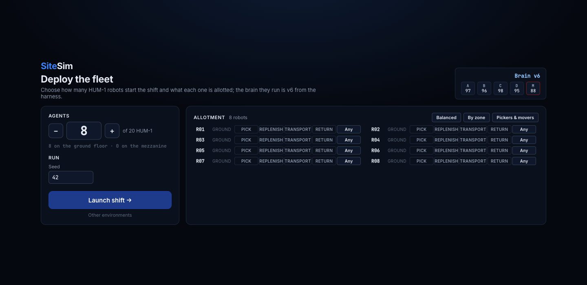
<br/><sub><b>Launch.</b> Pick the agent count, allot PICK / REPLENISH / TRANSPORT / RETURN (or Any) per robot, set the seed, launch the shift. The brain version and zone scores come live from the harness.</sub>
</div>

<br/>

<table>
<tr>
<td width="50%" valign="top">
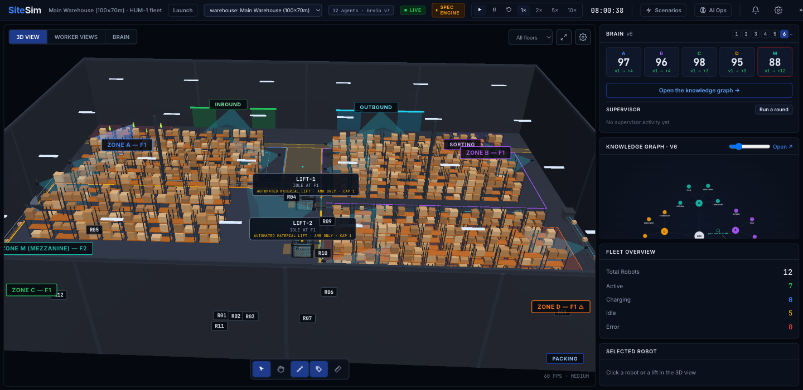
<p><b>The shift.</b> 12 legged HUM-1 robots across two floors, two freight lifts and the west stairs; the right sidebar holds the brain (zone scores with their change since v1, the knowledge graph) and the fleet statistics.</p>
</td>
<td width="50%" valign="top">
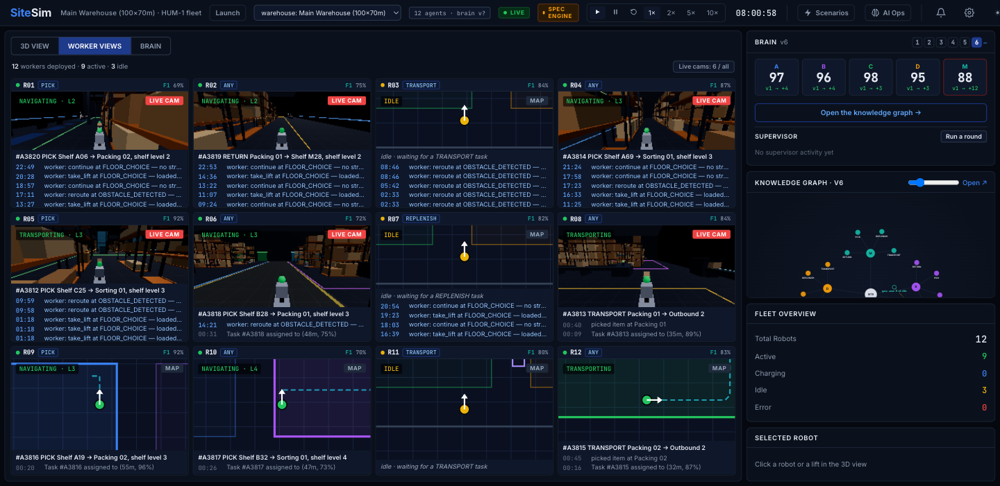
<p><b>Worker views.</b> One tile per deployed worker: the camera on its head, the task it was allotted, what it is doing now, and its trajectory, newest step on top, including the decisions the worker agent made at exception points.</p>
</td>
</tr>
<tr>
<td width="50%" valign="top">
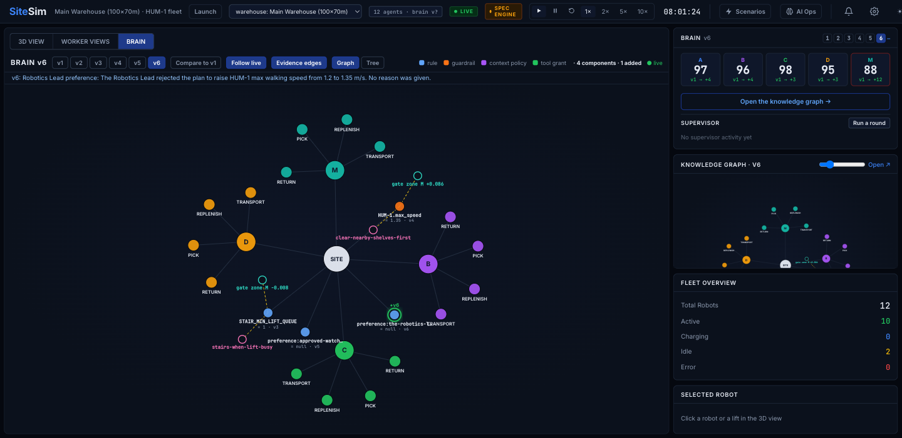
<p><b>The brain lights up.</b> Site, zones, the 16 task nodes, every rule and guardrail, and the evidence nodes behind them (the human habit, the gate run). When R07 reads <code>task:M:PICK</code>, the nodes on its scope path pulse and the edges glow.</p>
</td>
<td width="50%" valign="top">
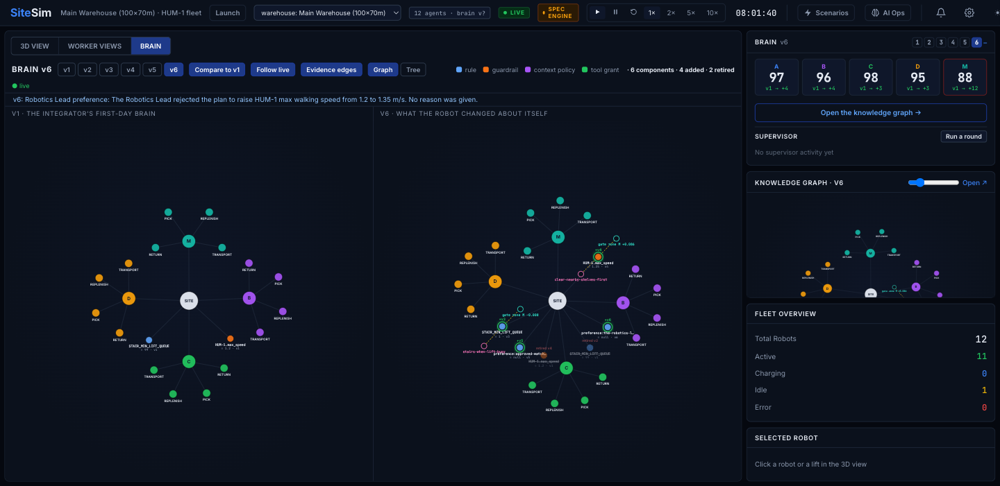
<p><b>v1 beside v6.</b> The integrator's first-day brain on the left; on the right what the robot changed about itself: the stairs rule (from a filmed habit, proved by its gate run), the approved walking speed, and the Robotics Lead's spoken preferences.</p>
</td>
</tr>
</table>

<br/>

## 📈 The result (measured on held-out shifts)

Brain v1 is an integrator's cautious first day: lifts only (`sim.STAIR_MIN_LIFT_QUEUE = 99`) and 80 % walking speed. Five promotions later, the gate re-ran v1 and the latest brain on **10 held-out shifts** (seeds 401–410) that neither the supervisor nor the Robotics Lead ever saw (`GET /api/proof`):

<table>
<tr>
<td align="center" width="25%"><h3>0.901 → 0.943</h3><sub>Fleet mean zone score,<br/>brain v1 → v5</sub></td>
<td align="center" width="25%"><h3>0.844 → 0.932</h3><sub>Zone M (the mezzanine),<br/>the worst zone on day one</sub></td>
<td align="center" width="25%"><h3>92.8 % → 96.4 %</h3><sub>Tasks finished on time</sub></td>
<td align="center" width="25%"><h3>90 → 48</h3><sub>Late tasks across the 10 shifts;<br/>dropped demand 269 → 193</sub></td>
</tr>
</table>

| Version | What changed | Where it came from | Gate |
| --- | --- | --- | ---: |
| v2 | Take the west stairs whenever anyone is already waiting for the lift (`STAIR_MIN_LIFT_QUEUE` 99 → 1) | habit `stairs-when-lift-busy` (Pexels clip) | M +0.033 on training, held-out agreed |
| v3 | Same lever, re-promoted on the v2 base | same habit | held-out agreed |
| v4 | Walking speed 1.2 → 1.35 m/s, a **locked** setting | habit `clear-nearby-shelves-first`; approved on the phone call | every zone up, M +0.086, held-out agreed |
| v5 | "Approved. Watch the cycle time for the next shift and tell me if it gets worse." | the Robotics Lead's own words, saved as a preference | n/a |

> [!IMPORTANT]
> Zone A moved −0.015 on the held-out set, inside the gate's tolerance; everything else rose. Zone M offers about 19 tasks a shift, so a single zone's score moves in steps of about 0.05, which is why the gate asks for held-out *agreement* (mean not down, no zone down by more than three tolerances) rather than held-out perfection. Candidates that looked good on training seeds and were refused by the held-out check are in the gate runs too: `STAIR_MIN_LIFT_QUEUE = 3` with `STAIR_MAX_LOAD = 0`, and `LIFT_XFLOOR_PENALTY_M = 20`.

<br/>

## 🔁 How it works

### The workflow

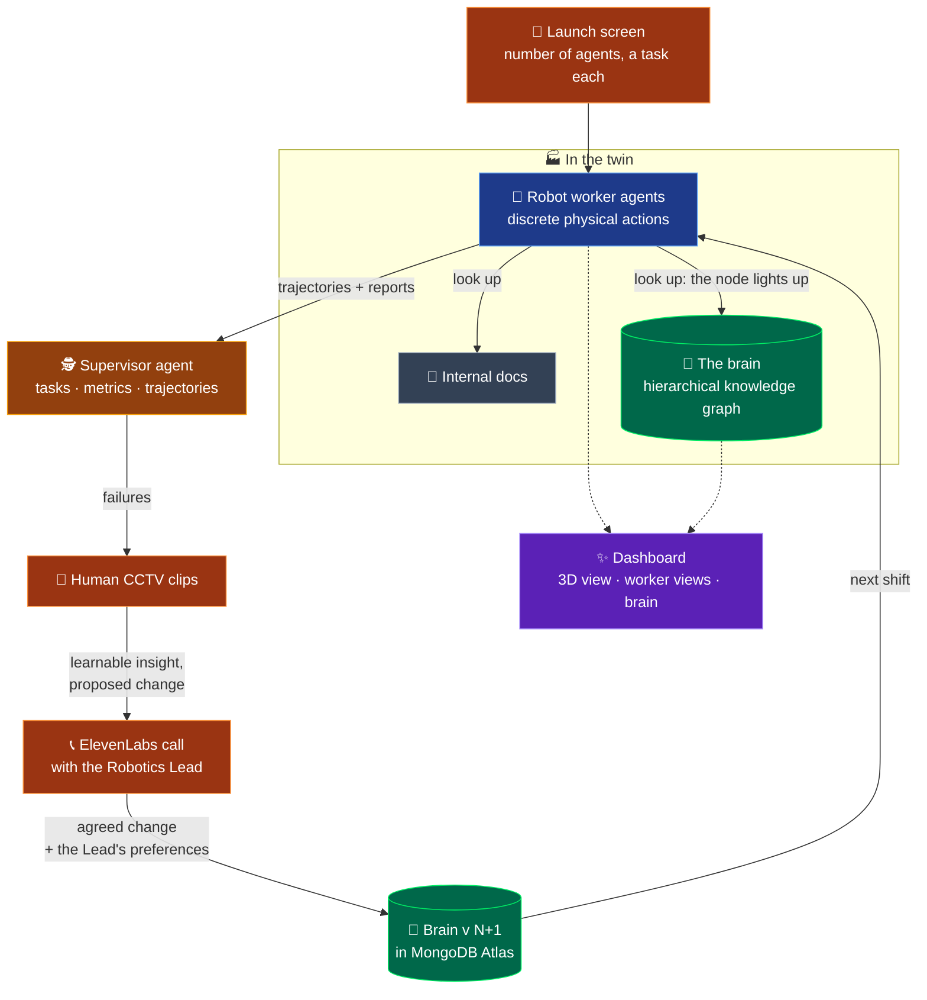

### One shift, call by call

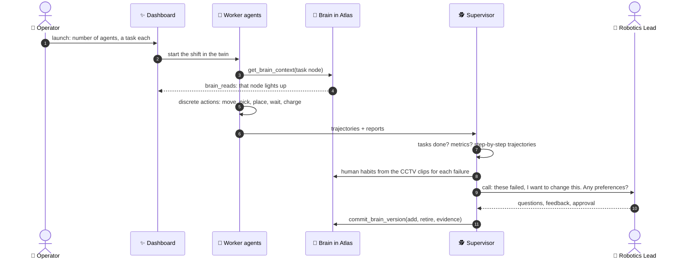

### Under the hood: checking a change before it lands

Every brain change is a typed setting edit, and the knowledge graph only commits one that names the evaluation behind it. A change can be replayed in the twin on training seeds and on sealed held-out seeds before it becomes a new version.

<details>
<summary><b>🔁 Click to open: the life of one gate run</b></summary>
<br/>

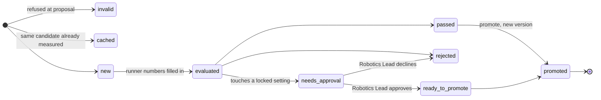

- **`invalid`**: unparseable, unknown setting, out of range, a `spec` or `fixed` setting, or a no-op. It never reaches the runner.
- **`cached`**: the same candidate proposed twice is one gate run, so a repeat never earns a second "pass" in Raindrop.
- **`needs_approval`**: a locked edit is not refused. The runner simulates it anyway (`allow_locked`), so the phone call can quote its effect.

</details>

<details>
<summary><b>🧪 Click to open: the worked example, brain v1 → v2, as documents</b></summary>
<br/>

In v1 the fleet never takes the stairs. Robots queue for the lift, and the jams land in `episodes` as `LIFT_QUEUE_JAM`, mostly in zone M. A habit from the clips says "skip the lift when it is queued." The improver proposes a threshold, the gate passes it, and `promote` writes v2. Nothing is edited in place:

```jsonc
// v1 component, retired (until: 2)
{ "_id": "rule:sim.STAIR_MIN_LIFT_QUEUE@site:main:v1", "compiles_to": { "op": "set", "target": "sim.STAIR_MIN_LIFT_QUEUE", "value": 99 },
  "since": 1, "until": 2 }

// v2 component, added (values illustrative)
{ "_id": "rule:sim.STAIR_MIN_LIFT_QUEUE@site:main:v2",
  "kind": "rule", "parent_id": "site:main", "key": "sim.STAIR_MIN_LIFT_QUEUE",
  "label": "Take the stairs when 2+ robots wait for the lift",
  "compiles_to": { "op": "set", "target": "sim.STAIR_MIN_LIFT_QUEUE", "value": 2 },
  "since": 2, "until": null,
  "evidence": { "gate_run_id": "gr-…", "signal": "LIFT_QUEUE_JAM",
                "episode_ids": ["ep:sh-…:LIFT_QUEUE_JAM:4120", "…"],
                "observed_at": "zone:M", "origin": "habit",
                "habit_id": "habit:skip-lift-when-queued" } }
```

`load_brain(2, "task:M:PICK")` returns the v2 rule. `load_brain(1, "task:M:PICK")` still returns the v1 rule, so every old brain replays exactly.

</details>

<br/>

## 🧠 The brain is a knowledge graph

The brain is not a prompt or a weights file. It is a **tree of scopes** with **typed components** hanging off it, plus **evidence edges** that make it a graph. It lives in one Atlas database, and one `$graphLookup` + `$lookup` aggregation loads everything that applies to a task.

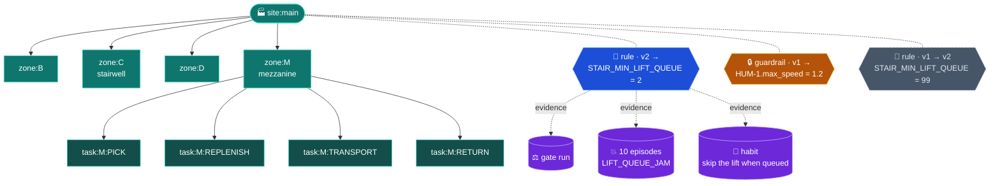

<sub>Every zone has the same four task nodes. Only zone M's are drawn. Today every component attaches at `site:main`, because the engine applies each setting fleet-wide. Where a problem was seen is kept in `evidence.observed_at`.</sub>

| Idea | How it works |
| --- | --- |
| **Four component kinds** | `rule` (an editable setting) and `guardrail` (a locked setting that needs a human) are populated. `context_policy` and `tool_grant` are reserved. |
| **Typed, runnable edits** | Every component carries `compiles_to: {op: "set", target, value}`. Free-text "when/then" can't run, so the engine only ever sees typed edits. |
| **Versions without edits** | Components are never changed. Each has `since` and `until`, so brain *N* is every component active at *N*, and any old brain replays exactly. |
| **Content-addressed IDs** | Shifts, gate runs and episodes are hashes of what produced them (engine SHA, spec hash, brain patch hash, seed). Re-running the same thing is a cache hit, never a duplicate. |
| **A concept ontology** | Trees of failure types, where time goes, outcomes and levers rank what the improver should try next. The worst zone's biggest non-productive time sink comes first. |
| **One projection** | The runner only ever receives `export_brain(V)`. Nobody hand-builds a brain JSON. |

<details>
<summary><b>🎛️ Click to open: everything the brain is allowed to change</b></summary>
<br/>

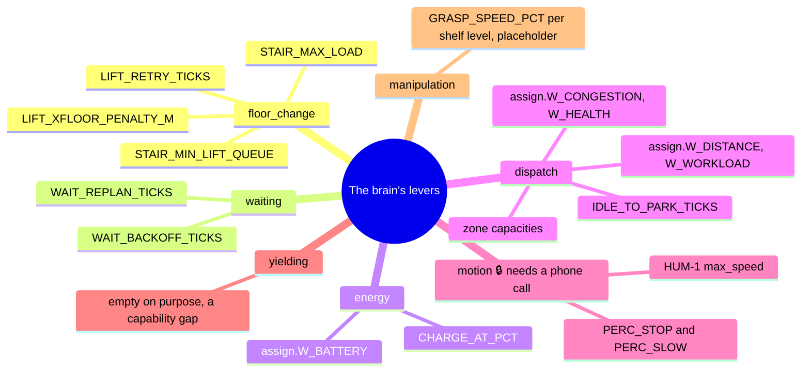

Each setting has a **status**: `editable` (the brain may set it within [min, max]), `locked` (it may differ from v1 only after a human approves the exact value), `fixed` (never approvable, for example the minimum robot separation) or `spec` (describes the building, like stair climb time, so the brain never sets it).

The **`yielding`** group is empty on purpose. No setting expresses "give way to another robot", so a habit from the clips that lands there is reported as a *capability gap* rather than hidden.

</details>

<details>
<summary><b>🗄️ Click to open: the collections and how they connect</b></summary>
<br/>

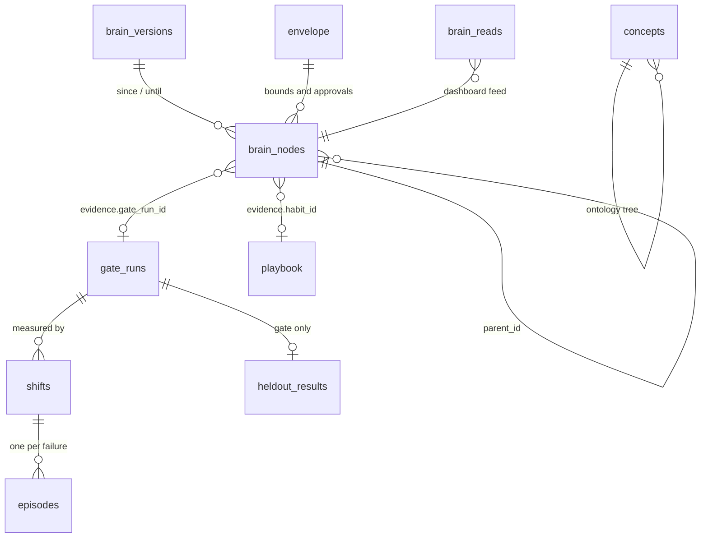

| Collection | Holds |
| --- | --- |
| `brain_nodes` | The scope skeleton plus every component, versioned |
| `brain_versions` | One document per version: parent, added, retired, hypothesis, approvals, `heldout_passed` |
| `envelope` | Bounds, status and approval history for each setting |
| `concepts` | The ontology: failures, time, outcomes, levers |
| `gate_runs` | One per evaluated candidate, with per-zone base, candidate and delta |
| `shifts`, `episodes` | Raw per-seed results for training and validation seeds, and one document per failure |
| `playbook` | Human habits from the clips, with helpful and harmful counters |
| `brain_reads` | Every `get_brain_context` read, so a dashboard can light up the node being read |
| `heldout_results`, `heldout_seeds` | 🔒 Gate only. The improver cannot read them at all |

</details>

<br/>

## 🔒 The held-out firewall

Promising "we test on data the optimizer never saw" is easy. Our guarantee is that **MongoDB itself refuses the read**. The knowledge graph opens one client per database user:

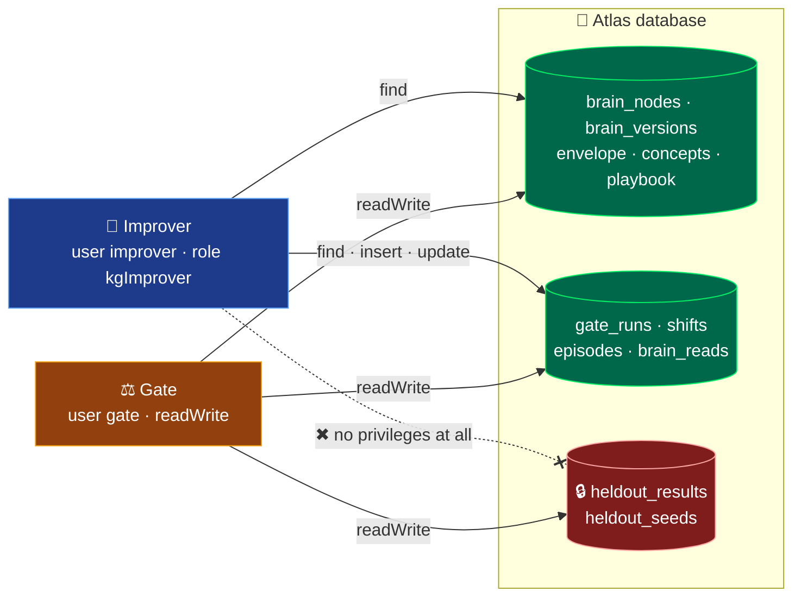

It has five layers, so no single mistake breaks it:

1. **Database**: the improver's role has no privilege on `heldout_*`, and `probe_heldout_denied` checks for the "unauthorized" error.
2. **Code, on input**: `record_proposal` and `record_shifts` accept only `split="train"` or `"val"`.
3. **Code, on the gate side**: `record_shifts` refuses to store a shift for any seed listed in `heldout_seeds`.
4. **Code, on output**: `get_context` and every view never read `heldout_*`.
5. **Shape**: `brain_versions` keeps only the boolean `heldout_passed`. The per-zone numbers go to the sealed collection.

> [!TIP]
> We checked whether Atlas's new Managed MCP Server could be scoped to these collection-level roles. It can't: an MCP configuration gets project-level roles only. So no agent in the improver loop gets an MCP configuration with data access, and the gate keeps its own native connection.

<br/>

## 📞 A human signs off by phone

After every shift, the supervisor phones the **Robotics Lead**. It says what the agents did, what failed, and what it wants to change in the brain, then lets the person drive the conversation. Edits to locked safety settings, like raising the fleet's top speed (`class.HUM-1.max_speed`), cannot land without that approval.

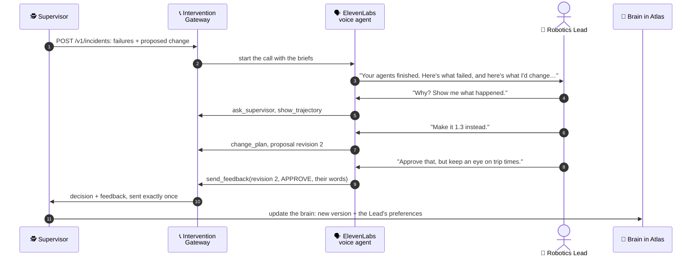

<sub>Values are illustrative.</sub>

<table>
<tr>
<td width="50%" valign="top">
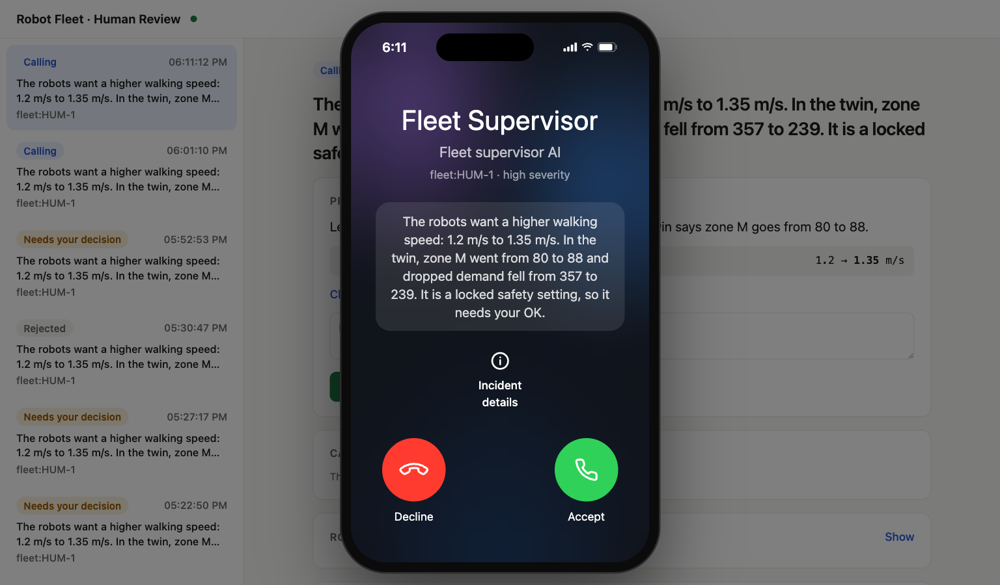
<p><b>The call comes in.</b> The supervisor's summary is written for a person: what the robots want, what the twin measured, and why it needs a human. Decline, or Accept and talk.</p>
</td>
<td width="50%" valign="top">
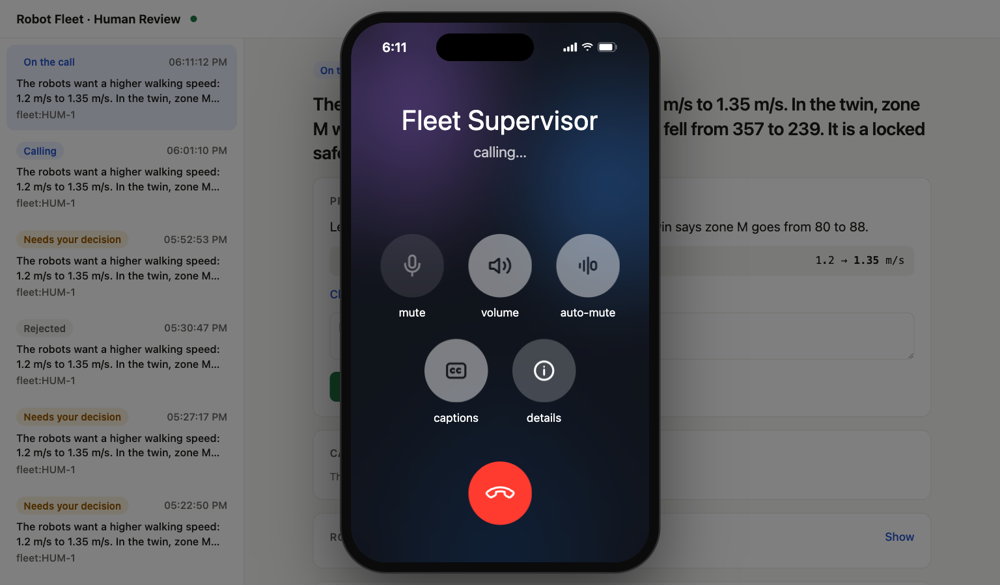
<p><b>On the call.</b> A real ElevenLabs conversation. Ask why, ask what went wrong in zone M, ask it to try a different value, then approve or reject. The decision and your words go back to the harness, which promotes the brain and saves your preference.</p>
</td>
</tr>
</table>

There are two pieces:

- **The Intervention Gateway** ([`gateway/`](gateway/)) is a Fastify + React app. It places the call, gives the voice agent four webhook tools, records **APPROVE / REJECT / DEFER** against an exact plan revision, and delivers the decision back to the harness exactly once through an outbox. Silence or a dropped call is never read as a decision.
- **The harness** ([`harness/`](harness/)) answers the agent's questions from the gate run and the failure episodes (`/supervisor/questions`), measures a revised value on the twin (`/proposals/:id/revisions`), and on `/feedback` records the approval against the exact value and promotes the brain; the person's words become a saved preference. An approval covers one exact value inside the setting's bounds and can never move the bounds. The **`kg-approval` agent** ([`approval_agent/`](approval_agent/)), a LangGraph workflow on **Atlas Agent Engine** with `deny_all` egress, does the same promotion step as a documented fallback.

<details>
<summary><b>🛠️ Click to open: the voice agent's tools and the incident lifecycle</b></summary>
<br/>

| Tool | What it does |
| --- | --- |
| `ask_supervisor(question)` | Asks the harness. Returns `ANSWERED`, `INSUFFICIENT_EVIDENCE`, `PENDING` (after 8 s) or `UNAVAILABLE`, so the agent never makes up an answer. |
| `show_trajectory(segment?)` | Pushes the robot's path onto the Robotics Lead's dashboard. |
| `change_plan(parameter_key, new_value, unit?, reason?)` | Creates a new revision of the proposal. |
| `send_feedback(revision, APPROVE \| REJECT \| DEFER, feedback?)` | Records the decision against that exact revision, with the person's own words. |

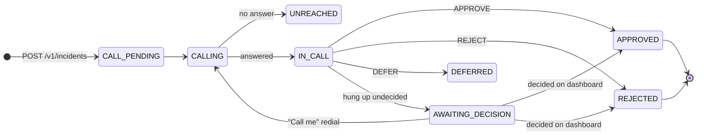

<sub>Simplified. Two partial unique indexes in MongoDB enforce one active call and one final decision per incident.</sub>

Telephony has three modes. `simulated` (the default) rings a softphone in the dashboard and opens a real ElevenLabs browser session. `twilio` places a real outbound call through ElevenLabs' Twilio integration or a SIP trunk, and only to allow-listed numbers. `scripted` is for tests.

</details>

<br/>

## 🧩 Architecture

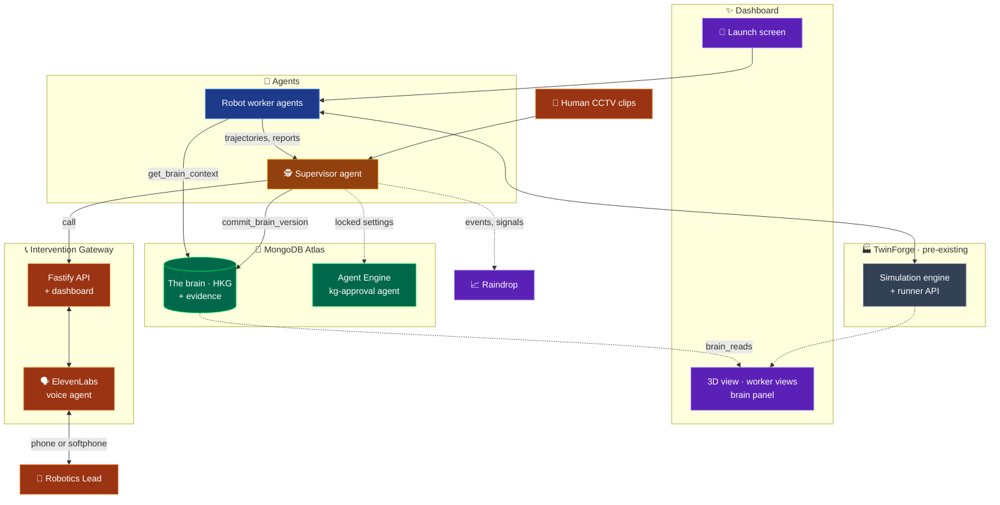

<sub>Dotted lines are designed or prototype connections.</sub>

### What each sponsor tool does here

| Tool | Its job in this project |
| --- | --- |
| 🍃 **MongoDB Atlas** | Holds the whole brain: scope tree, versioned components, evidence, ontology, playbook. `$graphLookup` loads a task's brain in one aggregation, and collection-level roles enforce the held-out firewall. Brain writes use insert-many and update-many only, never `$merge` or `$out`, so the write path stays easy to audit. |
| 🤖 **Atlas Agent Engine** | Runs `kg-approval`, the durable approval workflow that pauses for a human before a locked setting changes. |
| 🗣️ **ElevenLabs** | The conversational voice agent that phones the Robotics Lead, answers questions through webhook tools, and records the decision. |
| 📈 **Raindrop** | Gets one `candidate_brain` event per proposal and signals (`gate_passed`, `gate_failed`, `re_proposed`, `invalid_proposal`), so the pass rate per round, repeats and wasted proposals are visible. Real and dev projects are kept apart. `get_signals(shift_id)` reads them back by category. Raindrop is never on the critical path. |
| 🧠 **Claude** | The model behind the agents and the gateway's voice agent. The model is held fixed while the harness around it improves. |

<br/>

```text
mongodb-harness-engineering-hackathon/
├── README.md                     ← you are here
├── dev.sh                        one command: Mongo, venvs, seeds, every service
├── sitesim/                      the twin (from TwinForge) + today's additions
│   ├── src/harness/              runner contract: settings registry, brain compiler, headless runShift, sim server, worker mailbox
│   ├── src/engine/engine.ts      deterministic engine + the brain levers, stairs-vs-lift gate, 7 failure types, time split
│   ├── src/components/home/      the launch screen
│   ├── src/components/views/     3D, worker views, the force-directed brain graph
│   └── brains/v1.json            the two-component baseline
├── harness/                      the supervisor service (FastAPI)
│   ├── supervisor.py             Claude Agent SDK loop over the toolbelt; supervisor_rules.py the model-free fallback
│   ├── gate.py                   no zone worse, something better, locked → approval, held-out agreement, final proof
│   ├── tools.py                  the toolbelt: reads, propose_edit, run_gate, commit, call_robotics_lead (contract A)
│   ├── app.py                    routes B–F for the gateway, the dashboard read API, SSE, loop control
│   └── playbook.py               six habits from Pexels clips + four SOP pages
├── kg/                           the brain as a knowledge graph in Atlas (core, ontology, registry, views, hashing, Raindrop sink)
├── worker/                       the worker agent: stdio MCP server (brain context, SOP, playbook, Raindrop) + Devin/rules driver
├── gateway/                      the Intervention Gateway: ElevenLabs voice agent, phone-style call UI, decisions, outbox
├── approval_agent/               LangGraph agent on Atlas Agent Engine (documented fallback for promotion)
├── CONTEXT/, SCRATCHPADS/        background and the live design docs
└── docs/readme/                  the screenshots in this README
```

<br/>

## 🚀 Run it

Everything is in this repository on `main`. One script starts the whole stack; `.env` at the root carries the keys (names below, values never committed).

```bash
git clone https://github.com/ShashwatM3/mongodb-harness-engineering-hackathon.git
cd mongodb-harness-engineering-hackathon
cp gateway/.env.atlas.example gateway/.env      # fill in Atlas, ElevenLabs
./dev.sh                                         # Mongo (local or Atlas), venvs, seeds, then every service
```

| Service | Port | Start it alone |
| --- | ---: | --- |
| Dashboard (launch screen, 3D, worker views, brain) | 5180 | `cd sitesim && npx vite --port 5180` |
| Sim server (runner contract: `/health`, `/run_shift`, `/validate_brain`, `/settings`, `/worker/*`) | 8790 | `cd sitesim && npm run serve` |
| Harness (supervisor, gate, routes B–F, dashboard read API) | 8000 | `harness/.venv/bin/python -m uvicorn harness.app:app --port 8000` |
| Intervention gateway API (ElevenLabs tools, decisions) | 8787 | `cd gateway && npm run dev:server` |
| Robotics Lead call UI | 5173 | `cd gateway && npm run dev:web` |
| Worker agent driver (answers exception points) | — | `worker/.venv/bin/python worker/driver.py` |

Then open `http://localhost:5180/`, pick the agents, launch, and press **Run a round** in the Brain panel. A round that touches a locked setting rings `http://localhost:5173`. `GET http://localhost:8000/api/proof` is the v1-versus-latest held-out comparison.

<details>
<summary><b>Environment variables (names only)</b></summary>

| Variable | Purpose |
| --- | --- |
| `KG_MONGODB_URI_GATE`, `KG_MONGODB_URI_IMPROVER`, `KG_DB` | Atlas connection strings (one per database user) and the database name |
| `KG_RUNNER_URL` / `SIM_SERVER_URL` | The sim server (`http://localhost:8790`) |
| `GATEWAY_URL`, `GATEWAY_WEB_URL`, `HARNESS_TOKEN`, `HARNESS_OUTBOUND_TOKEN` | The gateway and the two bearer tokens (shared with `gateway/.env`) |
| `HELDOUT_SEEDS`, `FINAL_SEEDS`, `GATE_TOLERANCE`, `GATE_MIN_GAIN` | The gate: locked seed sets and its two thresholds |
| `SUPERVISOR_BACKEND` | `claude` (Claude Agent SDK on the subscription login) or `rules` (the same default order without a model) |
| `RAINDROP_WRITE_KEY`, `RAINDROP_QUERY_API_KEY`, `RAINDROP_PROJECT_ID`, `RAINDROP_DEV_PROJECT_ID` | Raindrop: one `candidate_brain` event per evaluated proposal, routed to the real or the dev project |
| `ELEVENLABS_API_KEY`, `ELEVENLABS_AGENT_ID`, `PUBLIC_BASE_URL`, `TOOL_SECRET` (in `gateway/.env`) | The voice agent; `npm run tunnel` gives the https URL and `scripts/update-agent-tools.ts` points the agent's tools at it |
| `CALL_MODE`, `ELEVENLABS_PHONE_NUMBER_ID`, `SUPERVISOR_PHONE` | `simulated` rings the browser; `twilio` rings a real phone through a number imported into ElevenLabs |

</details>

<details>
<summary><b>Tests</b></summary>

```bash
cd sitesim && npx vitest run                         # engine determinism, runner contract, brain compiler (50)
cd gateway && MONGODB_URI=memory npm test            # gateway acceptance, guards, Twilio (34)
kg/tools/test_mongo.sh && kg/.venv/bin/python -m pytest kg/tests -q     # knowledge graph against a real MongoDB (76)
```

</details>

<details>
<summary><b>The <code>python -m kg</code> commands</b></summary>

| Command | What it does |
| --- | --- |
| `setup` | Creates collections and indexes, seeds the brain, checks the held-out firewall |
| `seed` | Idempotent seed of skeleton, concepts, envelope and brain v1 |
| `sync-settings` | Pulls the runner's `GET /settings` into the envelope |
| `context V` / `suggest V` | What the improver sees for version V, and what to try next |
| `brain-context NODE [-v V]` | The supervisor's read of one task node |
| `explain ID` / `lineage V` | Rule → clip → episodes → gate run, and the version chain |
| `signals SHIFT_ID` | Raindrop's signals for one shift, by category |
| `snapshot V [--compare-to N]` | Nodes and links JSON for the graph view |
| `export V` | The brain exactly as the runner receives it |
| `check-v1 FILE` | Go/no-go hash check against `sitesim/brains/v1.json` |

</details>

<details>
<summary><b>The approval agent (Atlas Agent Engine), the documented fallback</b></summary>

```bash
cd approval_agent/agents/kg-approval
./sync_kg.sh                       # copy kg/ into src/kg (the build packages only this directory)
agentengine dev up --no-egress     # local playground on http://localhost:3000
agentengine invoke --json --session S "approve gr-…"
agentengine invoke --json --session S --resume '{"<interrupt id>": {"decision": "approve"}}'
```

</details>

<br/>

## 🎤 The demo, in three minutes

- [ ] **Launch.** Pick the number of agents, give each a task, and launch.
- [ ] **Watch.** The 3D view, then the switch to worker views: each robot's camera and its live, scrollable trajectory.
- [ ] **The brain lights up.** An agent reads the brain, and that node lights up in the brain panel.
- [ ] **Review.** The shift ends. The supervisor reads the reports, metrics and trajectories, and finds the failures, for example robots jammed at the zone M lift.
- [ ] **Learn.** It matches the failure to a CCTV clip: people skip the lift when it's queued.
- [ ] **Call.** The phone rings. The Robotics Lead asks why, adjusts the change, and approves.
- [ ] **Update.** The new brain version appears in the graph, glowing green. Click the new rule: clip → failures it fixed → gate run → held-out verdict.
- [ ] **Proof.** `GET /api/proof`: v1 against the latest brain on ten shifts nobody saw. 0.901 → 0.943.

<br/>

## 📚 Design docs

All design thinking is in the repo, written as it happened. When two documents disagree, the later one wins.

| # | Document | Read it for |
| :-: | --- | --- |
| 1 | [`iteration-05`](SCRATCHPADS/iteration-05-robot-form-and-build-decisions.md) | The latest round: robot form, the clips, the agent runtime |
| 2 | [`iteration-04`](SCRATCHPADS/iteration-04-robot-form-clips-and-team-sync.md) | Robot form, clips and team sync, with the team's inline feedback |
| 3 | [`knowledge-graph-info-packet`](SCRATCHPADS/knowledge-graph-info-packet.md) | The knowledge graph as built: collections, permissions, API, decisions |
| 4 | [`iteration-03`](SCRATCHPADS/iteration-03-supervisor-dashboard-and-sponsor-depth.md) | The supervisor as a tool-calling harness, the dashboard, Raindrop and MongoDB in depth |
| 5 | [`interface-contracts`](SCRATCHPADS/interface-contracts.md) | The exact shapes of `place_approval_call`, `get_brain_context`, `commit_brain_version` |
| 6 | [`brain-hierarchical-knowledge-graph`](SCRATCHPADS/brain-hierarchical-knowledge-graph.md) | The brain's original design |
| 7 | [`iteration-02`](SCRATCHPADS/iteration-02-warehouse-idea-research-and-workflow.md) | Why TwinForge, how improvement is proven, the team split |
| 8 | [`iteration-01`](SCRATCHPADS/iteration-01-warehouse-idea-evaluation.md) | The first verdict on the idea |
| 9 | [`CONTEXT/`](CONTEXT/README.md) | The brainstorm, research brief and planning chat that started it |

<br/>


<br/>

<div align="center">
<sub>Built in one day at Shack15, San Francisco · Thanks to MongoDB, Cerebral Valley, ElevenLabs and Raindrop</sub>
</div>
